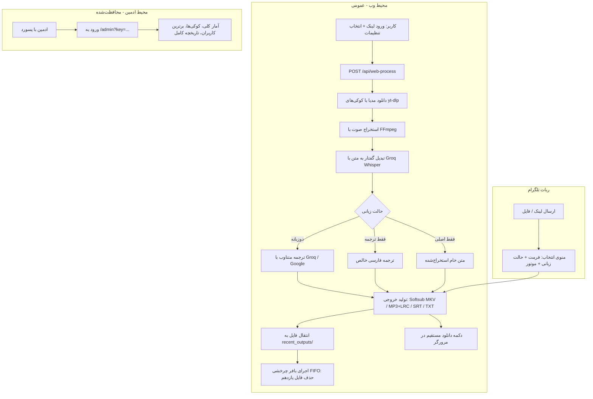

# سند معماری و برنامه پیاده‌سازی: استودیوی وب و مدیریت پیشرفته مدیا (SubCraft Future Roadmap)

این سند مرجع فنی و گام‌به‌گام پیاده‌سازی قابلیت‌های جدید پروژه **SubCraft** برای توسعه‌های آتی است.

---

## ۱. اهداف کلیدی طرح

1. **عمومی‌سازی داشبورد (`/` و `/dashboard`):**
   - دسترسی آزاد برای عموم و دوستان بدون نیاز به توکن یا رمز عبور.
   - فرم تعاملی و زیبا (Web Studio) جهت وارد کردن لینک ویدیو و تنظیم دقیق خروجی.
   - نوار وضعیت و پیشرفت زنده پردازش (Real-time Progress Tracker) با دکمه دانلود مستقیم فایل در مرورگر.
   - تعبیه دکمه هدایت به پنل مدیریت (`🔐 ورود ادمین`).

2. **انتقال بخش‌های حساس به پنل ادمین (`/admin`):**
   - احراز هویت با `ADMIN_PASSWORD` (از طریق کوئری پارامتر `key` یا HTTP Basic Auth).
   - انتقال کارت‌های آمار و گزارش عملکرد دیتابیس PostgreSQL.
   - انتقال کارت برترین کاربران (Top 3 Users).
   - انتقال سیستم مدیریت، آپلود، دانلود و Drag & Drop کوکی‌ها (YouTube و Instagram).
   - جدول جامع تاریخچه کارها با امکان جستجو، فیلتر و کپی آیدی‌ها.

3. **افزودن تفکیک حالت‌های زبانی (Language Modes) در وب و ربات تلگرام:**
   - 🌐 **دوزبانه متناوب (Bilingual):** نمایش متن زبان اصلی و ترجمه فارسی پشت‌سرهم (حالت پیش‌فرض).
   - 🇮🇷 **فقط ترجمه (Translation Only):** خروجی زیرنویس یا متن صرفاً به زبان فارسی.
   - 🔤 **فقط زبان اصلی (Original Audio Only):** استخراج متن زبان اصلی بدون اعمال ترجمه (صرفه‌جویی در هزینه/توکن و سرعت فوق‌العاده بالا).

4. **سیستم صف چرخشی نگهداری ۱۰ فایل اخیر (FIFO Storage Buffer):**
   - فایل‌های پردازش‌شده (ویدیو سافت‌ساب، موزیک با لیریکس، فایل SRT و ...) تا سقف ۱۰ فایل در سرور باقی می‌مانند.
   - **قانون صفر حذفیات قبل از ۱۰ فایل:** هیچ فایلی حذف نمی‌شود مگر اینکه تعداد کل فایل‌ها از ۱۰ عدد عبور کند. به محض تولید فایل یازدهم، قدیمی‌ترین فایل (FIFO) خودکار حذف می‌شود.
   - سازگاری کامل با چرخه حیات سرور: در صورت بیدار ماندن سرور، امکان دانلود مجدد ۱۰ فایل اخیر وجود دارد؛ در صورت رفتن به خواب (Sleep) در پلن رایگان، دیسک ریست می‌شود بدون اینکه خطایی در سیستم رخ دهد.

---

## ۲. دیاگرام جریان کار (Workflow Diagram)



---

## ۳. معماری فایل‌ها و ماژول‌های مورد نیاز

### ۱. سرویس مدیریت ذخیره‌سازی (`app/services/storage_cleaner.py`) `[NEW]`
```python
"""
وظیفه: مدیریت پوشه recent_outputs، ثبت متادیتای ۱۰ فایل اخیر و حذف خودکار فایل‌های قدیمی‌تر از ۱۰.
"""
import os
import shutil
import time
from pathlib import Path

OUTPUT_DIR = Path("data/recent_outputs")
MAX_RECENT_FILES = 10

class OutputStorageManager:
    @classmethod
    def register_output(cls, file_path: str, task_id: str, title: str) -> str:
        OUTPUT_DIR.mkdir(parents=True, exist_ok=True)
        # انتقال فایل به پوشه خروجی‌های پایدار موقت
        dest = OUTPUT_DIR / f"{task_id}_{Path(file_path).name}"
        shutil.move(file_path, dest)
        cls.enforce_retention_limit()
        return str(dest)

    @classmethod
    def enforce_retention_limit(cls):
        # مرتب‌سازی فایل‌ها بر اساس زمان ایجاد (قدیمی به جدید)
        files = sorted(OUTPUT_DIR.glob("*"), key=lambda f: f.stat().st_mtime)
        while len(files) > MAX_RECENT_FILES:
            oldest = files.pop(0)
            if oldest.is_file():
                oldest.unlink(missing_ok=True)
```

### ۲. سرویس پردازش وب (`app/services/web_processor.py`) `[NEW]`
- اجرای فرآیند دانلود و پردازش به صورت پس‌زمینه (FastAPI BackgroundTasks یا asyncio Task).
- ذخیره وضعیت در حافظه: `downloading`, `transcribing`, `translating`, `packaging`, `ready`, `failed`.
- متد استعلام وضعیت: `GET /api/web-process/{task_id}`.
- متد دانلود خروجی: `GET /api/web-download/{task_id}` با `FileResponse`.

### ۳. پشتیبانی از حالت‌های زبانی در ترجمه (`app/services/translator.py`) `[MODIFY]`
- افزودن پارامتر `language_mode`:
  - `bilingual`: خطوط اصلی و ترجمه زیرنویس به همراه برچسب‌های متناوب.
  - `translation_only`: فقط خطوط ترجمه شده با حفظ شماره و برچسب‌های زمانی SRT.
  - `original_only`: برگرداندن فایل SRT اصلی مستقیماً از خروجی Whisper بدون فراخوانی موتور ترجمه.

### ۴. تفکیک صفحات در وب‌سرور (`main.py`) `[MODIFY]`
- **مسیر `/` و `/dashboard`:** رندر صفحه عمومی وب‌استودیو شامل فرم ورودی، انتخاب گزینه‌ها، باکس نمایش پیشرفت لحظه‌ای، و دکمه دانلود.
- **مسیر `/admin`:** انتقال کدهای داشبورد مدیریتی فعلی (شامل جدول آمار، کوکی‌ها، جدول کارها) و اعتبارسنجی با `verify_admin_auth`.
- **لیست ۱۰ فایل اخیر:** نمایش لیست دانلودهای اخیر آماده در استودیو با امکان دانلود مجدد قبل از پاک شدن.

### ۵. گزینه‌های زبانی در تلگرام (`app/telegram_bot.py`) `[MODIFY]`
- در مرحله انتخاب خروجی، امکان انتخاب حالت زبانی نیز افزوده شود یا در قالب گزینه‌های مستقیم شفاف‌سازی گردد.

---

## ۴. چک‌لیست مراحل اجرا در آینده

- [ ] **گام ۱:** ساخت سرویس `app/services/storage_cleaner.py` با منطق صف چرخشی ۱۰ تایی.
- [ ] **گام ۲:** به‌روزرسانی `translator.py` برای تولید ۳ فرمت زبانی (دوزبانه، فقط فارسی، فقط اصلی).
- [ ] **گام ۳:** ساخت `app/services/web_processor.py` برای مدیریت کارها در وب.
- [ ] **گام ۴:** تفکیک روت‌های `main.py` به عمومی (`/dashboard`) و ادمین (`/admin`).
- [ ] **گام ۵:** افزودن اندپوینت‌های API شروع کار، بررسی وضعیت و دانلود فایل.
- [ ] **گام ۶:** هماهنگ‌سازی منوهای ربات تلگرام با ۳ حالت زبانی جدید.
- [ ] **گام ۷:** ارتقای نسخه در `app/config.py` به `v0.9.0` و ثبت جزئیات در `CHANGELOG.md`.
